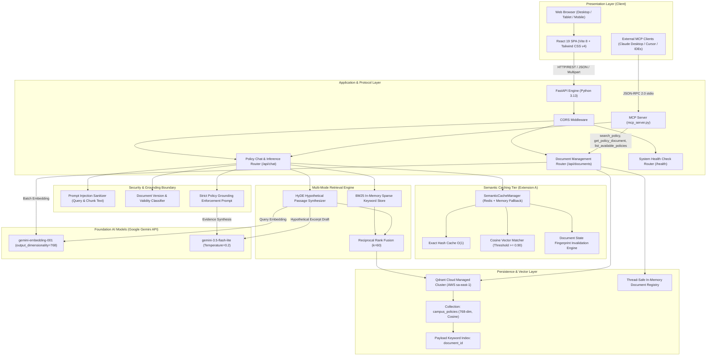

# System Architecture & Infrastructure

## 1. High-Level Architectural Topology

CampusPolicy AI is built on a decoupled, modular client-server architecture designed for factual reliability, low latency, and zero policy fabrication.

---

## 2. Component Boundary Specifications

### Presentation Tier (`/frontend`)
* **State Management:** Local React state with optimistic UI feedback for document deletions and streaming status toggles.
* **Component Architecture:**
  * `App.jsx`: Responsive layout container with mobile tabbed drawer.
  * `ChatDashboard.jsx`: Chat history stream, starter query suggestion pills, auto-scroll ref, and Markdown answer renderer.
  * `DocumentManager.jsx`: Drag-and-drop PDF upload target, extraction status feedback, and document catalog with clause counts.
  * `CitationPanel.jsx`: Expandable citation inspector linking answers directly to specific handbook pages and sections.
  * `RetrievalSelector.jsx`: Segmented mode control exposing real-time retrieval latency and hypothetical HyDE text artifacts.
  * `StatusBar.jsx`: Telemetry poll monitoring backend and cloud vector connectivity.

### Application Tier (`/backend/app`)
* **API Endpoints:**
  * `POST /api/documents/upload`: Validates file size (max 20MB) and format (`.pdf`), handles temporary disk staging, PyMuPDF text extraction, section-aware chunking, batch vector embedding, and Qdrant upsertion.
  * `GET /api/documents`: Returns list of indexed handbooks, clause counts, and upload timestamps.
  * `DELETE /api/documents/{id}`: Deletes points matching `document_id` via Qdrant payload filtering.
  * `POST /api/chat`: Executes multi-mode retrieval, evidence context assembly, prompt sanitization, Gemini grounded generation, and citation formatting.
  * `GET /health`: Real-time diagnostic check of Qdrant connection and Gemini configuration.

### Retrieval & Vector Storage Tier
* **Qdrant Vector Database:**
  * Vectors: 768 dimensions (reduced from 3072 via native Gemini API output dimensionality configuration to optimize query latency and storage).
  * Distance: Cosine similarity.
  * Filtering: Indexed keyword payload field `document_id` allowing instant, single-pass deletion of all vectors belonging to a specific handbook.
* **BM25 Sparse Store:**
  * Tokenized in-memory inverted index maintaining word frequency statistics for all ingested policy sections.
  * Evaluated alongside dense search in `hyde_hybrid` mode.

### AI Foundation Tier
* **Embedding Model:** `models/gemini-embedding-001` configured with `output_dimensionality=768`.
* **Generative Model:** `models/gemini-3.5-flash-lite` configured with `temperature=0.2` and `top_p=0.95` for deterministic factual adherence and strict abstention when evidence is insufficient.
