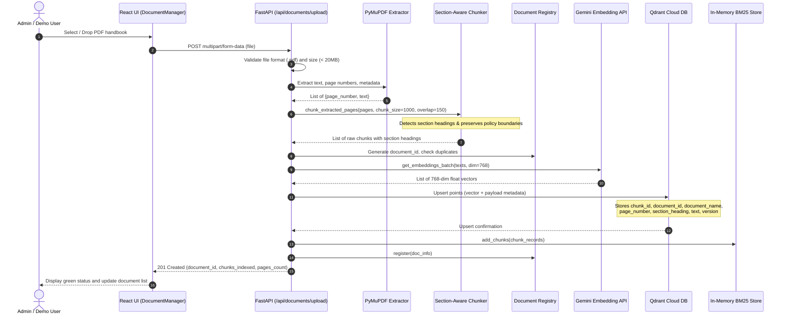
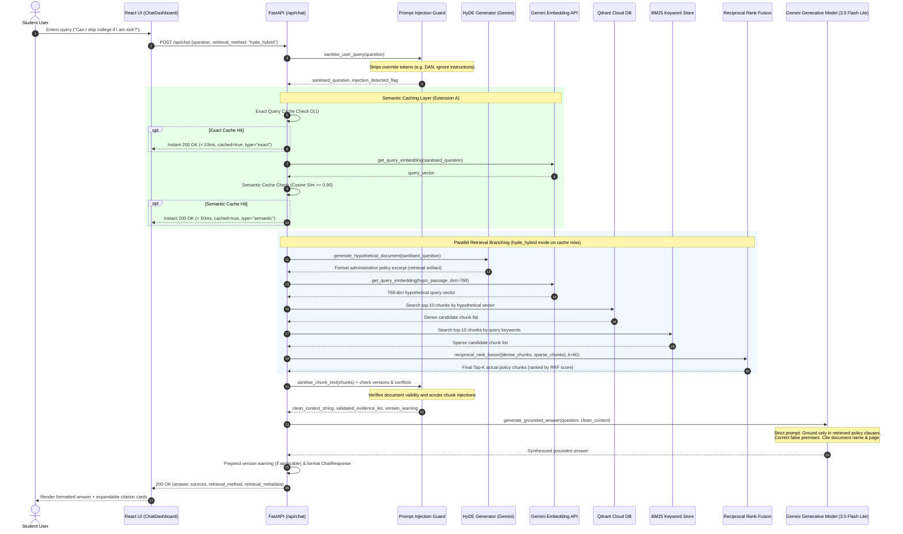

# Data Flow & Lifecycle Specifications

This document outlines the detailed sequence and data transformations across the two primary operational pipelines in CampusPolicy AI: **Document Ingestion** and **Grounded Chat Inference**.

---

## 1. Document Ingestion Pipeline

The document ingestion pipeline transforms raw university policy PDFs into structured, section-aware vector embeddings stored in Qdrant and indexed for keyword search in BM25.

---

## 2. Multi-Mode Chat & Retrieval Pipeline

The query pipeline handles informal student questions, executes query expansion via HyDE, retrieves candidate evidence chunks via hybrid fusion, evaluates guardrails, and generates a grounded response with citations.

